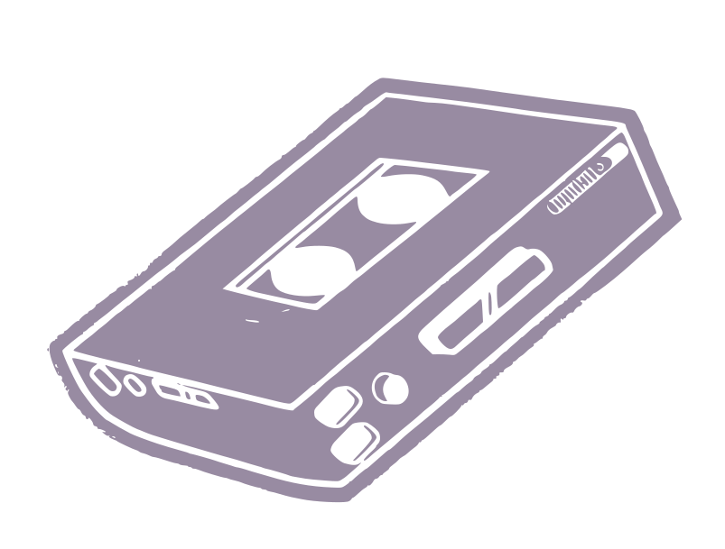
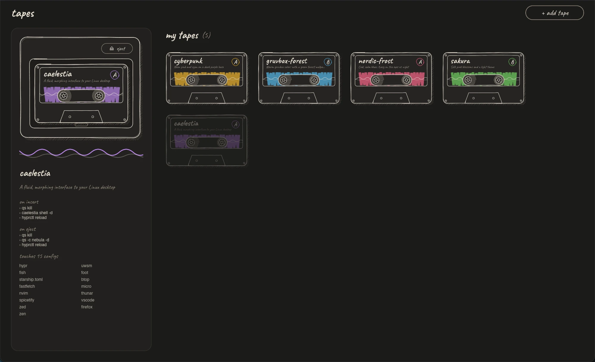

<br />
<div align="center">

<h1 align="center">tapes-deck</h1>



The GUI to make ricing easier.
Browse your dotfile setups, switch between them with a click and install new ones from a git repo.

A desktop app for [tapes](https://github.com/futurekismo-oss/tapes).

<a href="https://github.com/LilaccFlowerr/tapes-deck/issues/new">Report Bug</a>
&middot;
<a href="https://github.com/LilaccFlowerr/tapes-deck/issues/new">Request Feature</a>
&middot;
<a href="https://discord.gg/TVjsGzFAur">Join the Discord</a>

</div>

<div align="center">

[](https://github.com/LilaccFlowerr/tapes-deck/stargazers)

⭐ **Like it? Give it a star, it really helps other people find it.** ⭐

</div>

[](LICENSE)
[](Cargo.toml)
[](https://github.com/LilaccFlowerr/tapes-deck/releases)

---

<div align="center">
  
</div>

## What is this?

[tapes](https://github.com/futurekismo-oss/tapes) is a dotfile switcher: a *tape* is a
complete setup (a rice) that lives in `~/.tapes`, and you swap your whole config by inserting
one and get your old one back by ejecting it. tapes-deck is the same thing without the terminal.

- See all your tapes in one place, with their description, hooks and targets
- Insert a tape and eject it again with a click
- Install a tape straight from a git repo: pick a URL, and optionally a name, branch and subfolder
- See what tapes printed, so you know what happened when something goes wrong

It doesn't reimplement tapes: it runs the `tapes` command and shows you the result.
So everything you do in the app works the same in the terminal, and the other way around.

## Quickstart

1. Install tapes-deck (see below).
2. Run `tapes-deck`. It ships with [tapes](https://github.com/futurekismo-oss/tapes) and unpacks it to `~/.local/bin` on first start if you don't have it.
3. Add a tape: install one from a repo, or put one in `~/.tapes` yourself.
4. Insert it to try it out. Eject it to go back to your old config.

## Installation

tapes-deck bundles [tapes](https://github.com/futurekismo-oss/tapes), so there's nothing else to
install. It only runs on Linux (x86_64).

**Install script** (grabs the latest release, installs to `~/.local/bin` and adds an
app-launcher entry)

```bash
curl -fsSL https://raw.githubusercontent.com/LilaccFlowerr/tapes-deck/main/install.sh | sh
```

Make sure `~/.local/bin` is in your `$PATH`; the script tells you if it isn't.

**AppImage**: download `tapes-deck-x86_64.AppImage` from the
[releases page](https://github.com/LilaccFlowerr/tapes-deck/releases), `chmod +x` it and run it.
No install needed.

**Arch Linux**: build and install a pacman package from the `PKGBUILD` in this repo:

```bash
git clone https://github.com/LilaccFlowerr/tapes-deck
cd tapes-deck/packaging/aur
makepkg -si
```

Remove it later with `sudo pacman -R tapes-deck-bin`.

**Nix**

```bash
nix run github:LilaccFlowerr/tapes-deck
nix profile install github:LilaccFlowerr/tapes-deck
```

**From source**

```bash
git clone https://github.com/LilaccFlowerr/tapes-deck
cd tapes-deck
cargo run --release
```

You need Rust, `pkg-config` and the fontconfig development files.

The releases page also has the plain `tapes-deck-x86_64-unknown-linux-gnu` binary and a `.tgz`.
tapes-deck needs `fontconfig` at runtime, which almost every desktop already has.

### Uninstalling

If you used the install script:

```bash
rm ~/.local/bin/tapes-deck \
   ~/.local/share/applications/tapes-deck.desktop \
   ~/.local/share/icons/hicolor/scalable/apps/tapes-deck.svg
```

An AppImage is just a file; delete it.

---

## Roadmap

Ideas for what comes next, roughly in order:

- [x] **Bundled tapes**: tapes-deck ships with tapes and unpacks it if it's missing
- [ ] **Inline `tape.toml` editor**: edit a tape's config inside the app
- [ ] **Inline targets editor**: manage the (fake) `.config` targets of a tape without leaving the app
- [ ] **Starter tape**: a preconfigured tape that doubles as a tutorial. It installs itself, then
      walks you through configuring `tape.toml` and explains what each part does

## Contributing

Bug reports, ideas and pull requests are welcome. Read [CONTRIBUTING.md](CONTRIBUTING.md) first:
it has the project layout, how to set up, and the rules for pull requests, including how we
treat AI-assisted code. Questions are welcome in the [Discord](https://discord.gg/TVjsGzFAur).

## Credits

Built with Rust and [Slint](https://slint.dev). The handwriting font is
[Caveat](https://fonts.google.com/specimen/Caveat) (SIL Open Font License). The cassette drawing
is public domain, from Openclipart.

tapes-deck is a separate project from tapes. The author of tapes knows about it and sees it
as a fitting companion.

## Stonks 📈

<a href="https://star-history.com/#LilaccFlowerr/tapes-deck&Date">
  <picture>
    <source media="(prefers-color-scheme: dark)" srcset="https://api.star-history.com/svg?repos=LilaccFlowerr/tapes-deck&type=Date&theme=dark" />
    <source media="(prefers-color-scheme: light)" srcset="https://api.star-history.com/svg?repos=LilaccFlowerr/tapes-deck&type=Date" />
    
  </picture>
</a>

## License

GPL-3.0, see [LICENSE](LICENSE).
